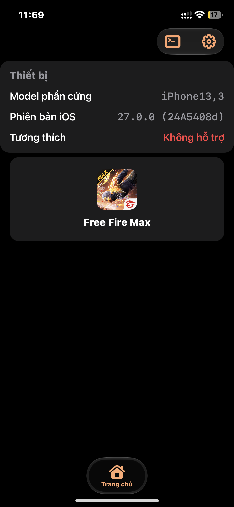
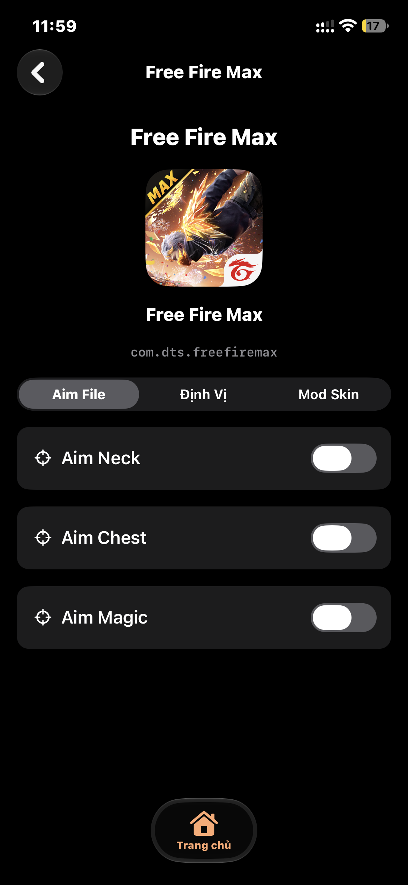

<p align="center">
  
</p>

<h1 align="center">SupportPatch</h1>

<p align="center">
  A native iOS workspace for app-container files, portable patches, limited cleanup, and PosterBoard wallpaper packages.
</p>

<p align="center">
  
  
  
  
</p>

<p align="center">
  <a href="README.vi.md">Tiếng Việt</a> ·
  <a href="docs/PATCH_GUIDE.md">Patch guide</a> ·
  <a href="#compatibility">Compatibility</a> ·
  <a href="#license">License</a>
</p>

> [!WARNING]
> SupportPatch is research software for personal device management. Keep a backup and use it only on devices and data you own. Simulator screenshots demonstrate UI only; they do not verify device-level access.

## Preview

<p align="center">
  
  &nbsp;
  
</p>

## What's new in 1.1.0

- **Broader iOS support** — verified range now includes iOS 17.0–17.7.x (kernel exploit), iOS 18.0–18.7.1 (kernel exploit), iOS 26.0–26.6.1, iOS 27 Developer Beta 1–4 / Public Beta 1–2, and iOS 27.0.1 (24A446).
- **Wrong-password feedback** — importing a legacy `.3105` patch with an incorrect password now shows "Incorrect password" instead of failing silently.
- **Onboarding for reinstalls** — onboarding reappears after overwriting the app with the same version, so fresh and overwritten installs both see the guided setup.

See the complete [Patch workspace guide](docs/PATCH_GUIDE.md).

## What's new in 1.0.1

- **Patch workspace v2** — build patches as a normal bundle-based directory tree under `On My iPhone/3105/Patches`; Apply and Export synchronize the workspace automatically.
- **Safer recovery** — original files are journaled before writes; Restore puts existing files back, removes files introduced by the patch, and removes patch-created directories once empty.
- **More capable Files tab** — independent tabs, preserved folder position, multi-selection, ZIP creation and extraction, plus a denser and more consistent grouped layout.

See the complete [Patch workspace guide](docs/PATCH_GUIDE.md).

## Highlights

- **App Data Browser** — resolves volatile container UUIDs to stable app bundle identifiers and exposes a native file workspace.
- **File operations** — search, preview, share, import multiple files, copy, move, paste, rename, delete, create files and folders, make ZIP archives, and safely handle name conflicts.
- **Portable patch packages** — current bundled patches use `.TRYSTORE`; legacy `.3105` packages remain importable. Bundle-based rules survive container-ID changes between devices; projects may include files or folders, support optional password protection, and can be imported from Files or a secure website link.
- **No jailbreak installation** — SupportPatch does not install a persistent jailbreak, bootstrap, or daemon and does not inject code into third-party apps. Because it still uses device exploits and can modify app data, no universal guarantee can be made against every app's integrity or jailbreak-detection policy.
- **Localized interface** — English, Vietnamese, and Simplified Chinese.

## Compatibility

SupportPatch enables device-level features only for builds it has verified. The gate lives in
[`ExploitSupportPolicy`](ThreeOneOSFive/helpers/SupportPolicy.swift), and this section is written
from those constants: a range listed here is a range the code accepts.

### Version ranges

| iOS | Range | Backend |
| --- | --- | --- |
| 17 | 17.0 – 17.7.x | kernel exploit |
| 18 | 18.0 – 18.7.1 | kernel exploit |
| 18 | 18.7.2 – 18.7.10 | pairing tunnel, listed builds only |
| 26 | 26.0 – 26.6.1 | `bad_query` |
| 26 | 26.6.2 | allowlist only, no named backend |
| 26 | 26.7 – 26.7.2 | `worse_query` |
| 27 | 27.0 – 27.2.1 | `worse_query` over the pairing tunnel |
| 27 | 27.3 | `worse_query`, experimental, build `24C5037i` only |

### Build allowlist

`verifiedVersions` and `verifiedIOS27BetaBuilds` enumerate the exact builds behind those ranges.
A build that is not in this list is unsupported, including another build of a listed version.

| System | Builds |
| --- | --- |
| 17.0 – 17.7.2 | `21A329`, `21A340`, `21A350`, `21A351`, `21A360`, `21B74`, `21B80`, `21B91`, `21B101`, `21C62`, `21C66`, `21D50`, `21D61`, `21E219`, `21E236`, `21E237`, `21F79`, `21F90`, `21G80`, `21G93`, `21G101`, `21H16`, `21H216`, `21H221` |
| 18.0 – 18.7.10 | `22A3354`, `22A3370`, `22B83`, `22B91`, `22C152`, `22C161`, `22D63`, `22D72`, `22D82`, `22E240`, `22E252`, `22F76`, `22G86`, `22G90`, `22G100`, `22H20`, `22H31`, `22H124`, `22H217`, `22H218`, `22H311`, `22H320`, `22H333`, `22H340`, `22H352`, `22H355`, `22H374` |
| 26.0 – 26.7 | `23A341`, `23A345`, `23A355`, `23B85`, `23C55`, `23C71`, `23D127`, `23D8133`, `23E246`, `23E254`, `23E261`, `23F77`, `23F81`, `23F84`, `23G71`, `23G83`, `23G90`, `23H24` |
| 27.0 – 27.3 | `24A5355q`, `24A5370h`, `24A5380h`, `24A5390f`, `24A5408d`, `24A5418b`, `24A5424a`, `24A5430a`, `24A435`, `24A437`, `24A446`, `24B119`, `24B5084k`, `24B5089g`, `24C5037i` |

Unlisted builds are marked unsupported rather than assumed compatible. The iOS 17–18 kernel exploit is opt-in (manual button) because a failed exploit attempt may restart the app.

## Installation notes

- The bundle identifier is `com.trystore.supportpatch` and the App Group is `group.com.trystore.supportpatch`; the group must be enabled for that identifier in the provisioning profile, so a wildcard profile is not enough.
- Device functionality requires signing with an **enterprise certificate**.
- SideStore, AltStore, 3uTools, and LiveContainer are not supported installation paths.
- Patch apply, restore, the file workspace and backups resolve the app's own data container and its App Group container only. Projects that target another app's container fail with a target-unavailable error instead of writing outside the sandbox.
- The source tree does not contain certificates, provisioning profiles, signed applications, or IPA files; release assets may provide an unsigned IPA.

## Project layout

```text
3105/
├── ThreeOneOSFive/          # SwiftUI app, helpers, native bridges, localizations
├── ThreeOneOSFive.xcodeproj # Xcode project and 3105 scheme
└── docs/images/             # Repository artwork and current UI previews
```

## Security and responsible use

Do not publish logs, app containers, cookies, account databases, or patch payloads containing personal data. Report security-sensitive issues privately to the maintainer.

## Credits

SupportPatch is developed and designed by [Hole30601](https://t.me/hole30601).

Special thanks to [0xjohnny](https://x.com/0xjohnny) for [FilzaSlop](https://github.com/0xjohnnydev/FilzaSlop) and related research:

- [MobileHouseArrest-PoC](https://github.com/0xjohnnydev/MobileHouseArrest-PoC) — ContainerManager identity-trust bug
- [Geod-MCM-PoC](https://github.com/0xjohnnydev/Geod-MCM-PoC) — `geod` MobileContainerManager `partDomain` traversal
- [InstallCoordination-PoC](https://github.com/0xjohnnydev/InstallCoordination-PoC) — persisted-state and final-symlink chain
- [CFPrefsZeroFile-PoC](https://github.com/0xjohnnydev/CFPrefsZeroFile-PoC) — `cfprefsd` zero-file creation

The project also builds on work from Pocket Poster/Nugget, CrazyMind90, forcequitOS, Dopamine, and their contributors. See [THIRD_PARTY_NOTICES.md](THIRD_PARTY_NOTICES.md) for full attribution and upstream links.

## License

Original portions of SupportPatch are distributed under the [GNU General Public License v3.0](LICENSE). Third-party components remain subject to their respective upstream copyright and license terms; see [THIRD_PARTY_NOTICES.md](THIRD_PARTY_NOTICES.md).

## Project merge status

This checkout now uses the uploaded `test1-main` project as the source of truth:

- the Support Patch GUI and patch-workspace flow live under `ThreeOneOSFive/`;
- Airlift is linked through `ThreeOneOSFive/AirliftFFI.xcframework` and can be rebuilt with `ThreeOneOSFive/build-airlift-ffi.sh`;
- legacy root-level TryStore sources and old `.3105` payloads were removed;
- the current bundled patch resources are the local `.TRYSTORE` files in `ThreeOneOSFive/Patches/`, copied into the IPA as a folder resource.

The application continues to use its existing path-validation, backup/restore, and package-integrity checks. It does not silently fall back to the removed legacy `.3105` files.
